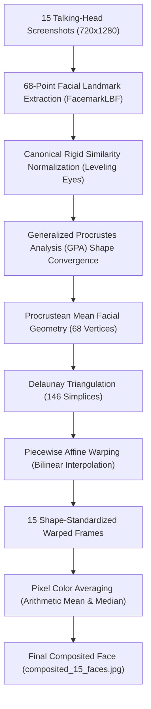

# 🧬 Procrustean Face Averaging: The Mathematical Composite Face

A rigorous implementation of **Procrustean Face Averaging** applied to our 15 curated viral talking-head creators, following the standard methodology developed in face perception research (such as *FaceResearch* / Tiddeman, Burt, & Perrett).

---

## 1. Mathematical Pipeline Overview

---

## 2. Core Mathematical Stages

### A. 68-Point Landmark Extraction
For each input image $I_k$, a 68-point facial landmark vector $S_k \in \mathbb{R}^{68 \times 2}$ is extracted using an OpenCV FacemarkLBF model coupled with YuNet face detection:
- **Jawline / Chin**: Points 0–16
- **Eyebrows**: Points 17–26
- **Nose Bridge & Tip**: Points 27–35
- **Eyes (Pupils, Eyelids, Corners)**: Points 36–47
- **Outer & Inner Lips**: Points 48–67

### B. Generalized Procrustes Analysis (GPA)
To compute the true average geometry independent of scale, rotation, and translation:
1. **Centering**: Shift each shape to centroid zero: $\tilde{S}_k = S_k - \mu_k$.
2. **Centroid Size Normalization**: Scale to unit Frobenius norm: $\hat{S}_k = \frac{\tilde{S}_k}{\|\tilde{S}_k\|_F}$.
3. **Iterative Orthogonal Procrustes Alignment**:
   For reference shape $\bar{S}$:
   $$\min_{R \in SO(2)} \|\hat{S}_k R - \bar{S}\|_F^2$$
   Solved via Singular Value Decomposition (SVD):
   $$M = \hat{S}_k^T \bar{S}, \quad M = U \Sigma V^T, \quad R = U \begin{pmatrix} 1 & 0 \\ 0 & \det(UV^T) \end{pmatrix} V^T$$
4. Update the mean shape $\bar{S}_{new} = \frac{1}{N} \sum_{k=1}^N \hat{S}_k R_k$, re-center, and re-normalize until convergence ($\|\bar{S}_{new} - \bar{S}_{old}\|_F < 10^{-7}$).
   - **Convergence**: Achieved in **4 iterations** with a residual difference of $5.19 \times 10^{-9}$.

### C. Delaunay Triangulation & Piecewise Affine Warping
1. The canonical mean shape $\bar{S}$ is mapped onto an $800 \times 1000$ canvas, and boundary anchor points are added along the perimeter to ensure full canvas coverage.
2. A Delaunay triangulation $\mathcal{T}$ is computed over the average shape vertices, generating **146 non-overlapping triangular simplices**.
3. For each image $k$, every triangle $T_m^{(k)}$ is warped onto the corresponding canonical average triangle $\bar{T}_m$ using the affine transformation matrix $A_m$:
   $$A_m = \begin{bmatrix} a & b & t_x \\ c & d & t_y \end{bmatrix}$$
   Warping is performed via continuous inverse coordinate mapping with bilinear interpolation (`skimage.transform.PiecewiseAffineTransform`).

### D. Pixel Color Averaging & Compositing
Across all 15 shape-standardized warped images $W_1(x, y), \dots, W_{15}(x, y)$:
- **Arithmetic Mean**:
  $$I_{avg}(x, y) = \frac{1}{15} \sum_{k=1}^{15} W_k(x, y)$$
- **Median Blend**:
  $$I_{median}(x, y) = \text{median}\left(\{W_1(x, y), \dots, W_{15}(x, y)\}\right)$$

---

## 3. Generated Artifacts

- [composited_15_faces.jpg](file:///Users/tarighian/most-viral-face/composited_15_faces.jpg): The primary high-resolution arithmetic average face ($800 \times 1000$).
- [composited_15_faces_portrait.jpg](file:///Users/tarighian/most-viral-face/composited_15_faces_portrait.jpg): Centered close-up portrait of the composite face ($640 \times 760$).
- [composited_15_faces_median.jpg](file:///Users/tarighian/most-viral-face/composited_15_faces_median.jpg): The median color composite, highlighting high-frequency skin textures and sharp eye definition.
- [composited_15_faces_landmarks.jpg](file:///Users/tarighian/most-viral-face/composited_15_faces_landmarks.jpg): The average face with the 146-triangle Delaunay mesh and 68 Procrustean landmark vertices overlaid.
- [procrustes_15_faces_grid.jpg](file:///Users/tarighian/most-viral-face/procrustes_15_faces_grid.jpg): A 16-panel comparison grid displaying each of the 15 input talking heads alongside the resulting composite face.
